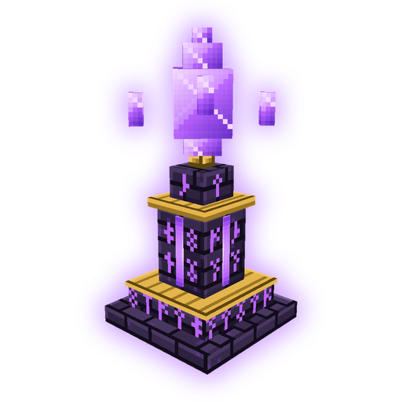

# Thermopolium

**Servidor RPG de Minecraft Java 1.20.1 (Fabric)**

---

## ¿Qué es Thermopolium?

Un servidor de Minecraft con alma de RPG, con su propio launcher. Entras al Gremio de Aventureros, eliges una clase y vas subiendo de rango completando misiones, mazmorras y exámenes de ascenso.

- ⚔️ **5 clases**: Guerrero, Paladín, Curador, Cazador y Hechicero, cada una con su arma y armadura propias.
- 🏅 **8 rangos**, de **F** a **SS**, con equipo que se forja y se mejora en el Yunque y la Forja Rúnica.
- 🏰 **Mazmorras y raids** generadas para jugar solo o en grupo.
- 🏙️ **La Ciudadela**: ciudad con NPC, tiendas, banco, subastas, correo y establo de monturas.
- 🐉 **Monturas**, terrestres, acuáticas y voladoras.
- 🎙️ **Chat de voz** por proximidad integrado.

## Cómo jugar

1. Descarga **[Thermopolium_Instalador.exe](https://github.com/TioPig/thermopolium-pack/releases/latest/download/Thermopolium_Instalador.exe)** e instálalo.
2. Abre **Thermopolium** desde el escritorio, escribe tu nombre de jugador y pulsa **JUGAR**.
3. La primera vez descarga Java, Minecraft y los mods (~1 GB). Después solo baja lo que cambie.

> Windows puede mostrar *"Windows protegió su PC"* porque el instalador no está firmado: pulsa **Más información → Ejecutar de todas formas**.

## Requisitos

| | |
|---|---|
| Sistema | Windows 10 u 11 (64 bits) |
| Memoria | 8 GB de RAM o más (puedes ajustar cuánta usa el juego en el launcher) |
| Disco | ~2 GB libres |
| Internet | Para la primera instalación y las actualizaciones |

## Actualizaciones

No tienes que volver a descargar nada: cada vez que pulsas **JUGAR**, el launcher revisa si hay cambios (correcciones, balance, contenido nuevo) y los instala solo.

---

Thermopolium es un proyecto de fans y no está afiliado a Mojang ni a Microsoft.

